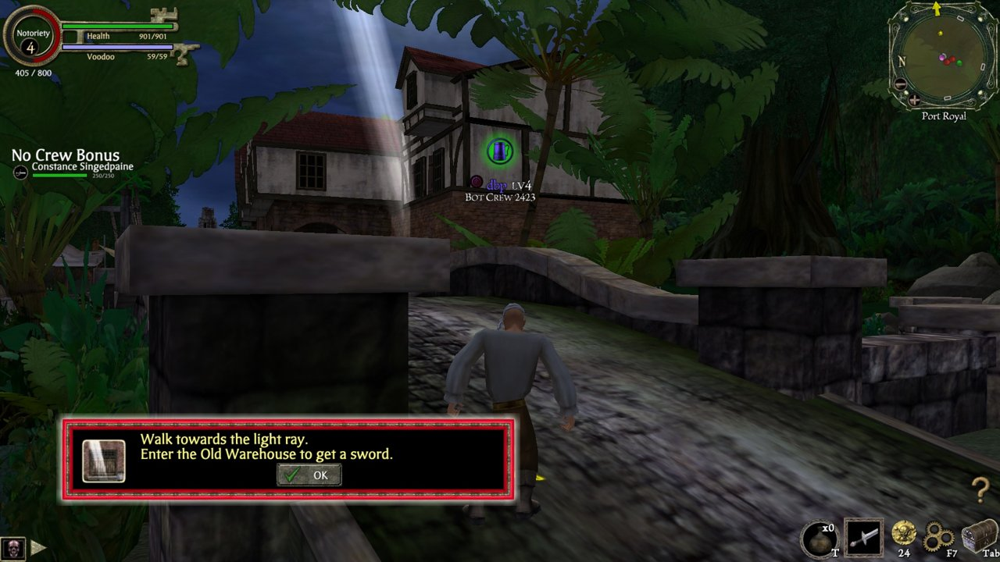
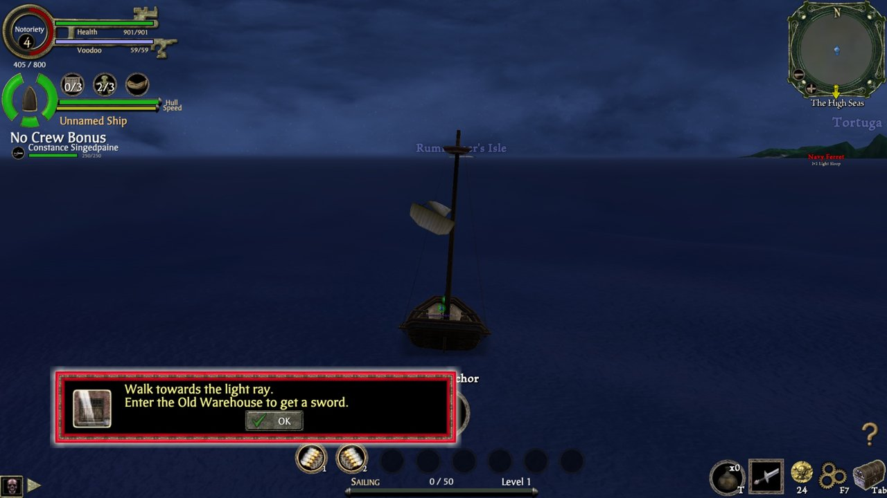

# Pirates Online Bots

Bots that play Pirates of the Caribbean Online on the [Custom Pirates Server](https://github.com/DaffyDabz/pirates-server),
built on [Pirates Online Classic](https://github.com/PiratesOnlineClassic/pirates-online-classic) (POC, the
open-source client and server). There are two kinds:

- **Test bots** run inside the real game client, log in as a test pirate and play a script: follow the quest tracker,
  talk to characters, click through every window like a player, fight, sail and dock. Every step goes to a log, so a
  run can be checked afterwards without anyone watching. They find the bugs the server's fixes are made from.
- **Player bots** are crewmates. A player bot joins your crew, follows you around town, rows out to your ship, mans a
  cannon and fights beside you on land, and does quests, sea battles and card games on its own when nobody needs it.

**Status:** both work on our server; the player bots are new and still learning. · **Visibility:** private for now
· **Last updated:** 2026-11-22

## Contents
- [Player bots](#player-bots)
- [Test bots](#test-bots)
- [What you need](#what-you-need)
- [How to run them](#how-to-run-them)
- [Built with](#built-with)
- [Coming soon](#coming-soon)
- [Recent changes](#recent-changes)
- [Credits and license](#credits-and-license)



## Player bots

One brain drives each bot (`pbot/b_brain.py`). Four times a second it looks at what is going on and picks what to do:
stand by its captain, follow him, board his ship, man a cannon, fight, or play on its own.

- **Crew first.** Invite a bot to your crew and it comes to you, even from another island. It follows you, rows out
  to your ship, and takes a cannon when there is something to shoot.
- **Skills.** What a bot does on its own comes from skill files in `pbot/skills/`: `quests.py` (quests and travel),
  `sea.py` (sailing and sea battles), `land.py` (land fights), `games.py` (card games) and `crew.py` (finding and
  helping its captain). [INTERFACE.md](pbot/skills/INTERFACE.md) explains how a new skill plugs in.
- **Bug reports.** When a bot gets stuck or something breaks, it writes a bug file with where it was and what it saw,
  and takes a picture.
- **Light on memory.** A bot runs a stripped-down game client (no textures, small window), about 1.5 GB each.
  `pbot/proto_login.py` tests logging in without the game at all, at about 40 MB, for lighter bots later.
- **Offline practice.** `pbot/skills/sim_sea.py` runs the sea skill against a simulated sea, so it can be tested
  without the game.



## Test bots

`walker.py` starts the real client offscreen and muted, picks the test pirate and runs a step script once the pirate
is in the world. A step script defines `run(H)` and yields either seconds to wait or `('until', fn, timeout)`; a
timeout is logged as a stall with a snapshot. `H` has what a script needs: quests, the current area, nearby objects,
walking to a target, fighting, sailing, and magic words. A run ends on its own after its time limit or when nothing has
happened for four minutes.

There are over 100 scripts. A few:

| Script | What it does |
|---|---|
| `s_story.py` | follows the main story quest by quest |
| `s_tutorial.py`, `s_newplayer.py` | a brand-new pirate's first steps |
| `s_dock.py`, `s_sail.py`, `s_launch.py` | launch, sail, steer back and dock a ship |
| `s_seabattle.py`, `s_shipfight.py`, `s_sink.py` | sea battles against enemy ships |
| `s_landfight.py`, `s_pistol.py`, `s_guards.py` | land fights |
| `s_cards.py`, `s_stud.py`, `s_parlor.py` | the card tables |
| `s_shop.py`, `s_sell.py`, `s_upgrade.py`, `s_repair.py` | shops and the shipwright |
| `s_friendtele.py`, `s_crew2.py`, `s_board.py` | friends, crews and boarding another pirate's ship |
| `s_relog.py`, `s_survive.py` | logging out and back in, and surviving a server restart |

The `t_*.py` files are offline tests for the bots' own logic (pathing, quest picking, sea fights) that run without
the game. `paths.py`, `islands.py`, `maps/` and `quest_spots.json` are how the bots find their way around.

## What you need

- A Pirates Online Classic client and a **development** server you control, such as the
  [Custom Pirates Server](https://github.com/DaffyDabz/pirates-server). The scripts use magic words (`giveQuest`,
  `areaTeleport`, `skipQuest` and others), so the test accounts need access to them.
- Panda3D's `ppython` matching the client (we use Panda3D 1.11 on Windows).
- A test account with one pirate on it for each bot. Use pirates you do not mind the bots playing.

## How to run them

The scripts expect the client in `C:\PiratesOnline\pirates-online-classic` and this repo in `C:\PiratesBots`; change
the paths at the top of each `.ps1` to match yours.

A test bot:

```
$env:BOT_ACCOUNT = 'bot1'
.\run_walk.ps1 -Tag story1 -Script s_story.py -Secs 600
```

A player bot:

```
.\pbot\run_bot.ps1 -Slot 1
```

Or set the environment yourself and run `ppython walker.py` from the client folder: `PROOF_SCRIPT` (the script),
`PROOF_EVOUT` (event log), `PROOF_SECS`, `PROOF_PIRATE`, `PROOF_OFFSCREEN=1`, plus the client's own `POC_TOKEN`,
`pocUsername`, `POC_GAMESERVER` and `GAME_ENVIRONMENT=DEV`. Logins for player bots go in
`pbot/accounts.local.json`, which is never committed.

## Built with

- Python inside the game client, through Panda3D's `ppython`
- PowerShell scripts to start and stop runs on Windows

## Coming soon

- [ ] Player bots that are always on, so there is always a crew to sail with
- [ ] Lighter player bots that do not need a whole game client
- [ ] Test bots playing the whole main story through, as proof

## Recent changes

- 2026-11-22 Player bots: one brain, five skills, bug reports and pictures. Over 100 test scripts and offline tests.
- 2026-10-04 First version: the test walker and ten step scripts.

## Credits and license

Pirates of the Caribbean Online and its art, names and characters belong to Disney. This is a free, non-commercial
fan project and is not affiliated with or endorsed by Disney. No game files are included.

- [Pirates Online Classic](https://github.com/PiratesOnlineClassic/pirates-online-classic) and its contributors.

All rights reserved for now.
